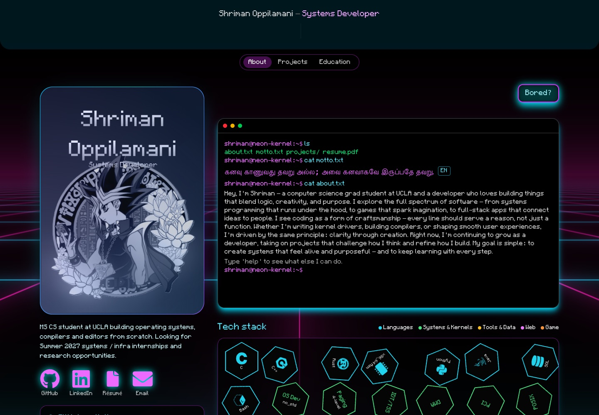
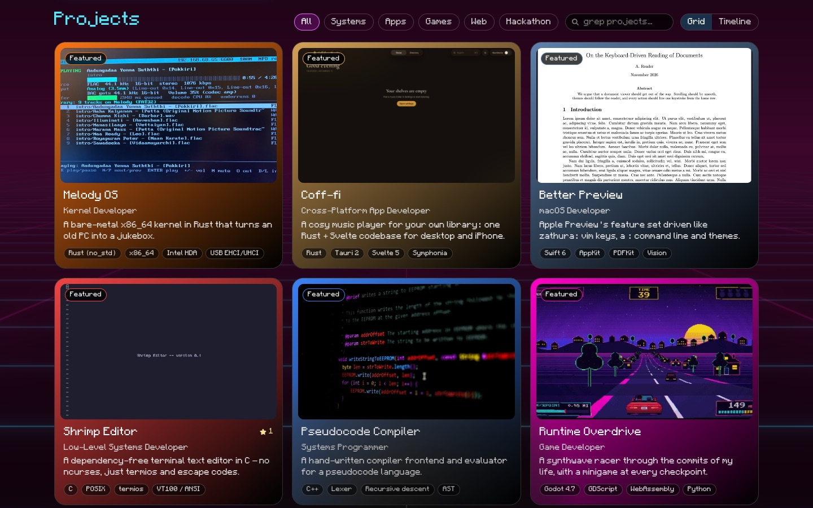
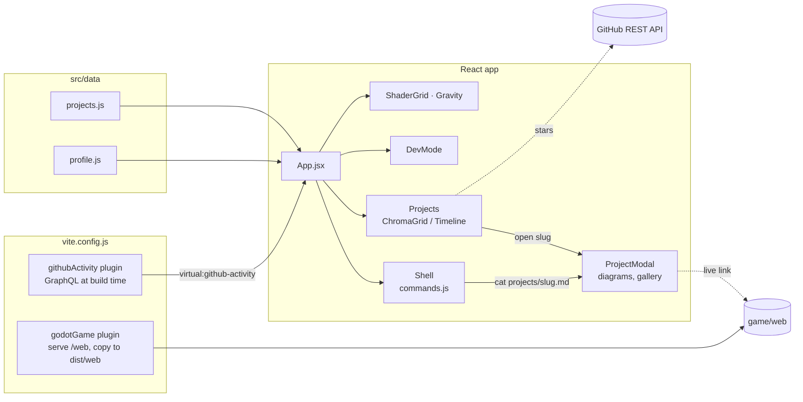

<div align="center">

# 🌌 NEON KERNEL

### _The Digital Garden of a Systems Wizard_




</div>

---

## Overview

**Neon Kernel** is my personal portfolio and experimental sandbox. It showcases projects focused on
**systems programming, performance and low-level software design**: a bare-metal Rust kernel, a
terminal editor in C, a native macOS PDF viewer, a Rust audio engine, and a Godot game you can play
right on the page.

I care about how software behaves _at runtime_ (memory, execution context, speed) rather than
treating systems as black boxes, and the site tries to feel the same way: a real shell you can type
into, a dev mode that shows what the page is doing, and no backend at all.

> _"Abstractions are earned, not assumed."_

> [!NOTE]
> All site content (projects, education, pitch, "Now", profile-card stats) lives in
> [`src/data/`](src/data). Edit it there, not in the components.

## Table of Contents

- [Features](#features)
- [Known Limitations](#known-limitations)
- [Toolchain](#toolchain)
- [Build & Run](#build--run)
- [Configuration](#configuration)
- [Adding a Project](#adding-a-project)
- [Updating the Game](#updating-the-game)
- [System Architecture](#system-architecture)
- [Source Tree](#source-tree)
- [License](#license)

## Features

<div align="center">

</div>

|     | Feature                  | Details                                                                                                                                                                         |
| :-: | :----------------------- | :------------------------------------------------------------------------------------------------------------------------------------------------------------------------------ |
| 🗂️  | **Project grid**         | Filter chips (Systems · Apps · Games · Web · Hackathon), search, grid or timeline view, cursor spotlight, live GitHub stars for public repos                                    |
| 🪟  | **Project modals**       | Accessible dialog (focus trap, Esc, scroll lock) with highlights, animated demo GIFs, an image gallery, a live-demo link and hand-built SVG architecture diagrams               |
| 💻  | **Interactive terminal** | A fake shell with a tiny virtual filesystem and tab completion: `help`, `ls`, `cd`, `cat projects/melody-os.md`, `neofetch`, `open resume`, plus `snake` and `typing` minigames |
| 🛠️  | **Developer mode**       | Konami code (↑↑↓↓←→←→BA) or `devmode`: a `top` widget, an `strace` log of real page events, and an outline mode                                                                 |
| 🧲  | **Tech-stack panel**     | Draggable hexagon badges on a Matter.js physics world                                                                                                                           |
| 🌆  | **Shader background**    | WebGL (ogl) synthwave grid; decorative animation pauses while the tab is hidden                                                                                                 |
| 📈  | **GitHub activity**      | Contribution heatmap baked in at build time, plus the most recently pushed repos                                                                                                |
| 🏎️  | **Game mode**            | A floating _"Bored?"_ button launches Runtime Overdrive, my Godot game, in the browser                                                                                          |
| 🖨️  | **Print**                | Printing the page gives a clean one-column summary                                                                                                                              |
| 📱  | **Responsive**           | Layout tuned for phones, tablets and wide desktops                                                                                                                              |

## Known Limitations

| Limitation                   | Notes                                                                                                                                                                        |
| :--------------------------- | :--------------------------------------------------------------------------------------------------------------------------------------------------------------------------- |
| GitHub heatmap needs a token | Read from `GITHUB_TOKEN` at build time only. Without it the box shows just the repo list                                                                                     |
| Star counts are rate-limited | Fetched from the unauthenticated GitHub API (60 requests/hour per IP), cached in `localStorage` for an hour. Private repos show a "source available on request" note instead |
| No WebP for newer assets     | Recent screenshots are JPEG and the demos are GIF (2–5 MB, loaded only when a modal opens)                                                                                   |
| Threaded Godot exports       | The current export is single-threaded. A threaded export needs COOP/COEP headers on the host                                                                                 |
| Static only                  | No backend, no contact form: links go to GitHub, LinkedIn, the résumé and email                                                                                              |

## Toolchain

| Requirement              | Why                                       |
| :----------------------- | :---------------------------------------- |
| Node.js 20.19+ or 22.12+ | Vite 7                                    |
| npm                      | Dependencies and scripts                  |
| Godot 4 _(optional)_     | Only to re-export the game in `game/web/` |

| Library                                      | Used for                                      |
| :------------------------------------------- | :-------------------------------------------- |
| React 19 · Motion · GSAP                     | UI, layout animations, spotlight and tweening |
| Tailwind CSS 4                               | Styling                                       |
| ogl · Matter.js                              | WebGL background · tech-stack physics         |
| Vitest · Testing Library · ESLint · Prettier | Tests, linting, formatting                    |

## Build & Run

```bash
git clone https://github.com/Shrimanpro/Neon-Kernel.git
cd Neon-Kernel
npm install
npm run dev        # http://localhost:5173, game served at /web/
```

| Script                            | What it does                                                     |
| :-------------------------------- | :--------------------------------------------------------------- |
| `npm run build`                   | Production build to `dist/`, with the game copied to `dist/web/` |
| `npm run preview`                 | Serve the build locally                                          |
| `npm test`                        | Vitest (jsdom) suite                                             |
| `npm run lint`                    | ESLint                                                           |
| `npm run format` / `format:check` | Prettier                                                         |

## Configuration

```bash
cp .env.example .env.local   # gitignored
# then set GITHUB_TOKEN=... (no scopes needed for public contribution data)
```

> [!WARNING]
> The token is only read by `vite.config.js` during the build. Only the day counts end up in
> `dist/`, never the token. Do not rename it with a `VITE_` prefix, or Vite will expose it to the
> client.

`public/.htaccess` sets caching, MIME and compression headers for the Apache/LiteSpeed host and is
copied into `dist/` as-is.

## Adding a Project

1. Drop the image in `public/assets/` (and an optional animated GIF for the modal).
2. Add an entry to `projects` in [`src/data/projects.js`](src/data/projects.js). Array order is
   display order.
3. Required fields: `slug`, `title`, `role`, `categories`, `dates`, `image`, `tech`, `summary`,
   `highlights`, `story`, `borderColor`.
4. Optional fields:

| Field                    | Effect                                                                  |
| :----------------------- | :---------------------------------------------------------------------- |
| `featured`               | "Featured" badge on the card                                            |
| `github` / `githubLabel` | Source link and live star count                                         |
| `private`                | "Source available on request" note instead of a link                    |
| `demo`                   | Animated GIF shown in the modal instead of the still image              |
| `imageAlt` · `imageSize` | Alt text · intrinsic size (prevents layout shift)                       |
| `gallery`                | `[{ src, alt, caption, size }]` extra images under the highlights       |
| `live`                   | `{ href, label }` button, e.g. to the hosted game                       |
| `diagram`                | Key into [`components/diagrams/index.js`](components/diagrams/index.js) |

The terminal picks new projects up automatically (`ls projects`, `cat projects/<slug>.md`).

## Updating the Game

The Godot web export lives in `game/web/`. Re-export from Godot into that folder and keep the export
name `index`. A small Vite plugin serves it at `/web/` in dev and copies it to `dist/web/` on build,
skipping Godot's `.import` files.

> [!TIP]
> If `game/web/` is missing, the build still succeeds with a warning; only the _"Bored?"_ link
> will 404.

## System Architecture



<details>
<summary><b>Loading strategy</b></summary>

The header, profile card and terminal render first. `Projects`, the tech-stack physics panel, the
project modal, dev mode and the WebGL background are `React.lazy` chunks loaded after first paint,
so GSAP, Matter.js and the diagrams do not block the initial render.

</details>

<details>
<summary><b>Terminal engine</b></summary>

`components/shell/commands.js` is a pure command engine with no DOM access. Commands return output
lines plus an optional `effect` object (open a project, start a game, toggle dev mode), and
`Shell.jsx` carries the effect out. That split keeps the shell unit-testable.

</details>

## Source Tree

```
Neon-Kernel/
├── src/
│   ├── App.jsx              # page layout, lazy chunks, modal state
│   ├── data/                # projects.js, profile.js — all site content
│   ├── hooks/               # useGithubRepo (cached star counts)
│   └── index.css            # Tailwind, theme, print styles
├── components/
│   ├── sections/            # Layout, Sidebar, Projects, GithubActivity
│   ├── shell/               # Shell, commands engine, Snake, TypingTest
│   ├── devmode/             # top / strace / outline overlay
│   ├── diagrams/            # SVG architecture diagrams + layout kit
│   ├── background/          # ShaderGrid (ogl)
│   ├── fancy/physics/       # Matter.js tech-stack panel
│   ├── ChromaGrid.jsx       # project cards with cursor spotlight
│   └── ProjectModal.jsx     # project detail dialog
├── game/web/                # Godot HTML5 export (Runtime Overdrive)
├── public/                  # assets, résumé, robots, sitemap, .htaccess
├── docs/                    # README screenshots
└── vite.config.js           # Godot + GitHub heatmap plugins, test config
```

## License

MIT License.

<div align="center">

_"Running on high caffeine and low latency."_

</div>
